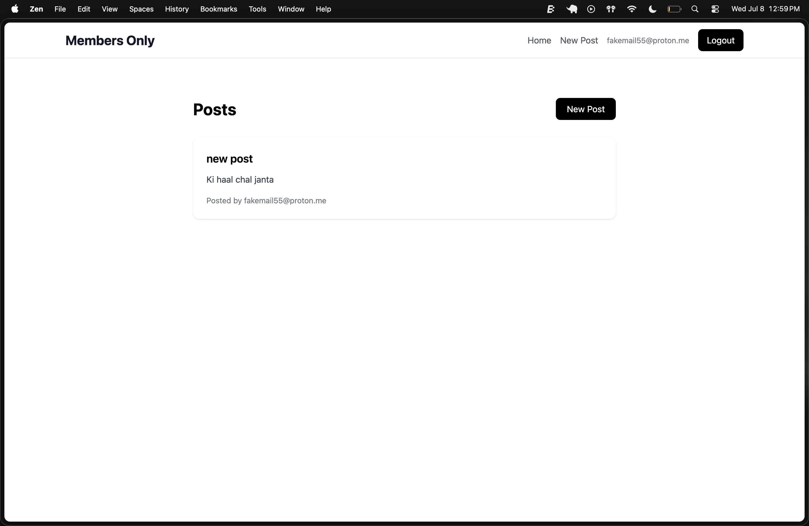
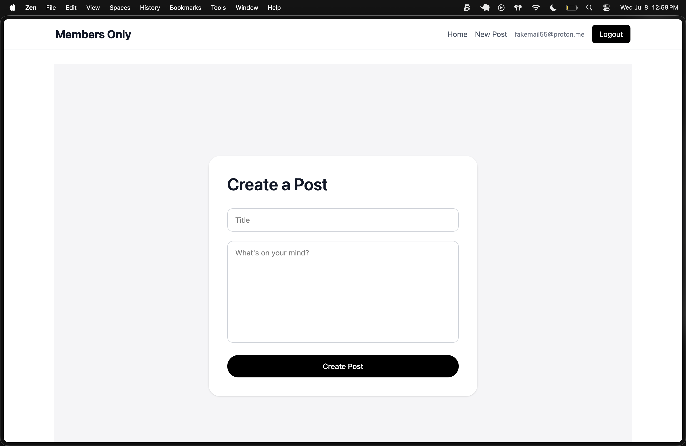
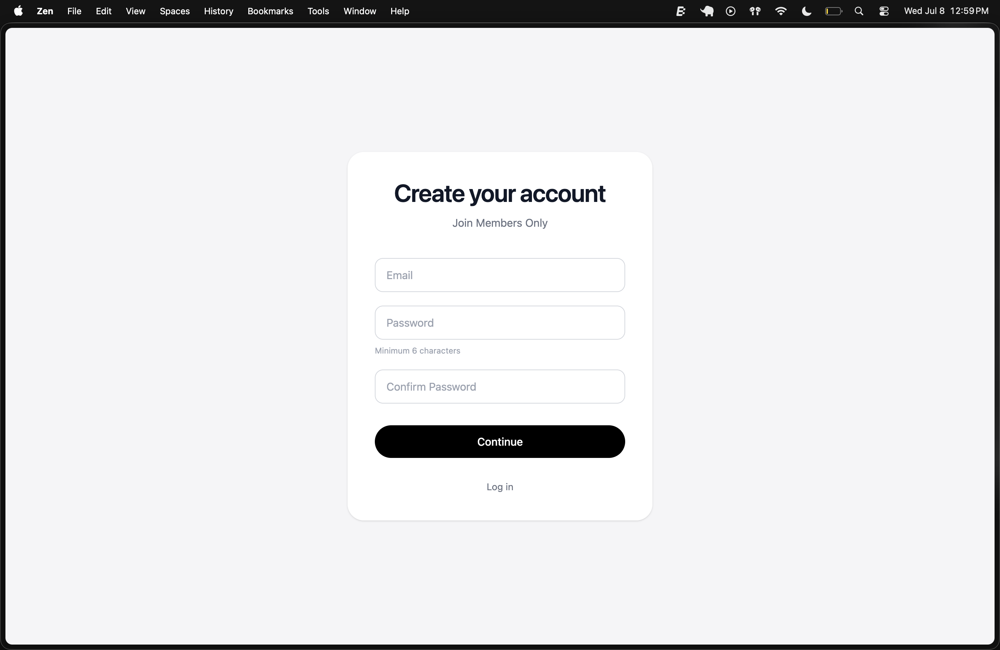

# Members Only

A private posting platform built with **Ruby on Rails** where anyone can read posts, but only authenticated members can see who wrote them and create new posts.


---

## ✨ Features

- 🔐 User authentication with Devise
- 📝 Create new posts
- 📖 View all posts
- 👤 Only logged-in users can view the author's identity
- 🎨 Responsive UI built with Tailwind CSS
- 🧩 Reusable partials (Navbar & Forms)
- ✅ Rails strong parameters
- 🔒 Protected routes using `before_action`

---

## 🛠️ Built With

- Ruby
- Ruby on Rails
- Devise
- Tailwind CSS
- SQLite3
- Importmaps

---

## 📸 Screenshots

### Home Page



### Create Post



### Login



---

## 🚀 Getting Started

Clone the repository

```bash
git clone https://github.com/yourusername/members-only.git
```

Move into the project

```bash
cd members-only
```

Install dependencies

```bash
bundle install
```

Setup the database

```bash
bin/rails db:create
bin/rails db:migrate
```

Start the server

```bash
bin/dev
```


---

## 📂 Project Structure

```
app/
├── controllers/
├── models/
├── views/
│   ├── devise/
│   ├── posts/
│   └── shared/
├── assets/
└── helpers/
```

---

## 📖 What I Learned

During this project I practiced:

- Authentication with Devise
- User sessions and registrations
- Rails associations
- `belongs_to` and `has_many`
- Resourceful routing
- Strong Parameters
- MVC architecture
- Partials and layouts
- Tailwind CSS in Rails
- Form helpers
- Authorization with `before_action`

---

## 🧠 Database Design

### User

| Column | Type |
|---------|------|
| email | string |
| encrypted_password | string |

### Post

| Column | Type |
|---------|------|
| title | string |
| content | text |
| user_id | references |

Relationship

```
User
 └── has_many :posts

Post
 └── belongs_to :user
```

---

## 🎯 Future Improvements

- Edit posts
- Delete posts
- User profiles
- Comments
- Likes
- Pagination
- Search
- Rich text editor
- Dark mode

---

## 👨‍💻 Author

**Priyanshu Kumar**

GitHub: https://github.com/yourusername

---

## 📜 License

This project was built for **The Odin Project** curriculum and is available for educational purposes.